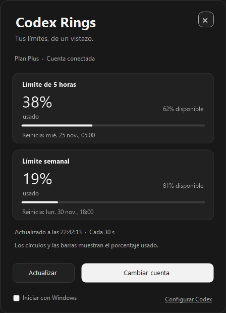
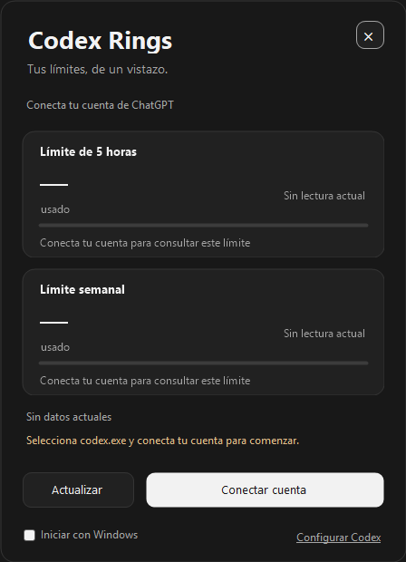

<p align="center">
  
</p>

<h1 align="center">Codex Rings</h1>
<p align="center">Tus límites de Codex, directamente en la barra de tareas de Windows.</p>

<p align="center">
  <a href="https://github.com/AlexRoac/codex-rings/releases/latest"></a>
  
  <a href="LICENSE"></a>
</p>

<p align="center">
  <a href="https://github.com/AlexRoac/codex-rings/releases/latest">Descargar</a> ·
  <a href="#primer-uso">Primer uso</a> ·
  <a href="#preguntas-y-solución-de-problemas">Ayuda</a> ·
  <a href="docs/README.en.md">English</a>
</p>

---

Dos círculos blancos muestran cuánto has usado de tus límites de **cinco horas** y **semanal**, con el número dentro y un arco proporcional alrededor. Un clic abre un panel con disponibilidad, fechas de reinicio y acceso a tu cuenta.

**Los datos vienen de Codex.** La app consulta las cuotas de la cuenta conectada cada 30 segundos; no estima el consumo a partir de tokens ni genera conversaciones para medirlo.

<p align="center">
  
</p>
<p align="center"><sub>Ejemplo de interfaz con datos de muestra. Los porcentajes de tu cuenta serán distintos.</sub></p>

## Qué incluye

- **Dos indicadores en la barra:** uno para cinco horas y otro para la semana.
- **Círculos de 24 px**, números de 10 px y fondo transparente cuando la integración ampliada está disponible.
- **Panel oscuro:** porcentaje usado, porcentaje disponible, plan y reinicio de cada límite.
- **Inicio de sesión oficial** en el navegador o uso de tu sesión existente.
- **Detección de Codex** y selección manual de `codex.exe`.
- **Inicio automático opcional** desde el panel.
- **Una sola instancia:** volver a abrir el `.exe` muestra el panel de la app que ya está ejecutándose.
- **Sin telemetría propia**, sin claves de API dentro del ejecutable y sin suscripción adicional de Rings.

Codex Rings es un proyecto independiente. No está afiliado, patrocinado ni desarrollado por OpenAI. Codex y ChatGPT son productos de sus respectivos titulares.

## Requisitos

| Requisito | Detalle |
| --- | --- |
| Sistema | Windows 11 x64. La v1 no se ha validado en Windows 10, ARM64 o barras de tareas modificadas. |
| Runtime | .NET Framework 4.8 o posterior. No requiere instalar un SDK para usar el `.exe`. |
| Codex | Una instalación oficial que incluya `codex.exe` y admita `app-server`. |
| Cuenta | Una cuenta de ChatGPT con cuotas de Codex disponibles. Una clave de API por sí sola no ofrece estos límites de plan. |
| Conexión | Internet para iniciar sesión y consultar los límites. |

La conexión en vivo se comprobó con Codex CLI `0.171.0-alpha.13.2`. El protocolo de Codex puede cambiar entre versiones; la compatibilidad con todas ellas no está garantizada.

**El binario de Codex no viene incluido.** Puedes instalarlo siguiendo la [documentación oficial de Codex CLI](https://developers.openai.com/codex/cli/), o usar el que incluye la extensión oficial de Codex para Visual Studio Code.

## Descargar

Abre [Releases](https://github.com/AlexRoac/codex-rings/releases/latest) y elige:

| Archivo | Para qué sirve |
| --- | --- |
| `CodexRings.exe` | Versión portable. Descarga, guarda en una carpeta estable y ejecuta. |
| `CodexRings-v1.0.0-win-x64.zip` | Ejecutable, instalador local opcional, documentación y licencia. |
| `SHA256SUMS.txt` | Sumas SHA-256 de los archivos publicados. |

Para comprobar una descarga en PowerShell:

```powershell
Get-FileHash .\CodexRings.exe -Algorithm SHA256
```

Compara el resultado con `SHA256SUMS.txt` de **esa misma release**. La v1 no incluye firma Authenticode ni un sistema de actualización automática.

## Primer uso

1. Ejecuta **CodexRings.exe**. Se abrirá el panel y aparecerán los dos indicadores en el área de notificación.
2. Si ya tienes una sesión compatible de Codex, espera la primera lectura. Verás tu plan, porcentajes y reinicios.
3. Si Codex no se detecta, pulsa **Configurar Codex** y selecciona el ejecutable oficial `codex.exe`.
4. Pulsa **Conectar cuenta** y completa el inicio de sesión en el navegador. Rings no pide tu contraseña.
5. Si Windows guarda los indicadores en el menú de iconos ocultos, abre la flecha y **arrastra ambos a la barra visible**. También puedes gestionarlos en Configuración > Personalización > Barra de tareas.

<details>
<summary>Ver el panel antes de conectar una cuenta</summary>



</details>

### Detectar el ejecutable de Codex

La app busca una ruta guardada, un `codex.exe` junto a Rings, la extensión oficial de VS Code, el `PATH` y las ubicaciones habituales del paquete npm de Codex. Si tu instalación está en otro lugar, usa **Configurar Codex**.

Selecciona un ejecutable oficial: Rings lo iniciará en modo `app-server`. No selecciones `node.exe`, un acceso directo, un archivo `.cmd` o un ejecutable de origen desconocido.

### Instalar en una carpeta local

La versión portable funciona sin instalarse. Si prefieres una copia en `%LOCALAPPDATA%\CodexRings` y accesos directos, extrae el ZIP completo y ejecuta:

```powershell
.\install.ps1
```

El script copia el programa a tu perfil, crea un acceso en el escritorio y otro de inicio automático. No requiere administrador. Usa una sesión de PowerShell que permita ejecutar scripts locales.

### Iniciar con Windows

Activa **Iniciar con Windows** en el panel. La app crea un acceso directo de inicio para el usuario actual. Al entrar a Windows aparecerán los círculos, sin abrir el panel.

Si usas la versión portable, conserva el `.exe` en la misma ruta. Si lo mueves, desactiva y vuelve a activar esta opción desde la nueva ubicación.

## Cómo interpretar los indicadores

| Lo que ves | Significado |
| --- | --- |
| `70` dentro del círculo | Has usado el 70 % de esa cuota. No significa que te quede un 70 %. |
| Arco al 70 % | Representa el mismo porcentaje usado. |
| `30% disponible` en el panel | Es el complemento del uso reportado por Codex. |
| `—` | No hay una lectura actual de esa cuota. Nunca se presenta como un cero supuesto. |
| Fecha de reinicio | La hora que informa Codex, mostrada en la zona horaria de tu Windows. |

Pasa el cursor sobre un círculo para saber si corresponde a **cinco horas** o **semana**. Windows permite reordenarlos, por lo que no dependas únicamente de su posición.

La lectura se actualiza cada **30 segundos**. Si la consulta falla, Rings muestra el estado de error y deja de presentar los porcentajes anteriores como actuales. El paso de la hora de reinicio no se interpreta como un uso de cero: se espera una nueva lectura del servidor.

### Controles

| Acción | Resultado |
| --- | --- |
| Clic en un círculo | Abre el panel de uso. |
| Clic derecho | Abre el menú de actualización, cuenta, configuración y salida. |
| Arrastrar un icono | Cambia su posición dentro del área de notificación de Windows. |
| Actualizar | Solicita una nueva lectura sin esperar al siguiente intervalo. |
| Cambiar cuenta | Inicia el flujo oficial de acceso de Codex. |
| Cerrar el panel o pulsar Escape | Cierra el panel y mantiene los indicadores. |
| Cerrar Codex Rings en el menú | Sale de la aplicación y retira los dos indicadores. |

## Cuenta y privacidad

Rings reutiliza la sesión y la configuración que gestiona Codex. No incluye la cuenta del desarrollador, no guarda una contraseña propia ni copia tu archivo de autenticación a la aplicación.

**Cambiar de cuenta también cambia la sesión compartida de Codex en ese equipo.** Si usas `CODEX_HOME`, el proceso de Codex hereda esa variable. La app no crea una cuenta independiente ni consume créditos por generar respuestas.

Los ajustes de Rings se guardan en `%LOCALAPPDATA%\CodexRings`. El inicio automático es un acceso directo en la carpeta Inicio del usuario. No hay telemetría de Rings ni envíos de diagnósticos al desarrollador.

Consulta [SECURITY.md](SECURITY.md) para más detalles y para comunicar problemas de seguridad.

## Integración con la barra de Windows

Los dos espacios se registran mediante `Shell_NotifyIcon` y conservan identificadores estables. Para dibujar círculos de 24 px, Rings crea gráficos transparentes como **ventanas hijas de la barra**, centrados en esos espacios. El ratón sigue llegando al icono original para conservar el clic, la descripción y el arrastre.

Si esa integración ampliada no funciona, la app vuelve a los iconos pequeños normales. No modifica `explorer.exe`, no inyecta código y no requiere reemplazar la barra de tareas.

Windows administra el orden y la visibilidad. Rings ocupa el área de notificación; no puede ubicarse libremente en el espacio del clima o a la izquierda de la flecha como un componente del sistema. Las personalizaciones de Explorer y los cambios de Windows pueden afectar el dibujo ampliado.

## Preguntas y solución de problemas

**No aparecen los círculos.** Abre el menú de la flecha y busca los dos iconos de Rings. Arrástralos al área visible. Comprueba que la app no esté cerrada desde su menú.

**Aparece una raya.** Abre el panel. Revisa la conexión, selecciona `codex.exe` si no se encuentra e inicia sesión. Una cuenta autenticada solo con API key puede no devolver las cuotas del plan.

**No coincide con una captura o con otro panel.** Rings muestra uso, no disponibilidad. Comprueba la misma cuenta y ventana de cuota, y pulsa Actualizar. Puede haber hasta 30 segundos entre lecturas automáticas.

**Los iconos se ven pequeños.** Puede estar activa la alternativa nativa: ocurre si no hay dos espacios visibles distintos o si Windows impide el dibujo ampliado. Coloca ambos iconos fuera del menú oculto. La v1 se diseñó para la barra estándar de Windows 11.

**Se movió o actualizó Codex.** Abre Configurar Codex y vuelve a seleccionar el ejecutable. La ruta anterior puede haber quedado obsoleta.

**El navegador terminó el acceso, pero el panel no cambia.** Espera el siguiente intervalo o pulsa Actualizar. Asegúrate de completar el flujo en el mismo equipo donde corre Rings.

**¿Puede ejecutarse en segundo plano?** Sí. Activa el inicio automático o utiliza `CodexRings.exe --background`.

**¿Cómo se actualiza?** Cierra Rings, sustituye el `.exe` con el de la nueva release y vuelve a abrirlo. Los ajustes de tu perfil se conservan.

**¿Cómo se desinstala?** Desactiva Iniciar con Windows, cierra Rings y elimina su ejecutable y acceso del escritorio. Si usaste el instalador, elimina también `%LOCALAPPDATA%\CodexRings`. Esto no elimina tu instalación ni tu sesión de Codex.

## Compilar y comprobar

Requiere Windows x64 y el compilador de .NET Framework de Windows. No utiliza NuGet ni bibliotecas de terceros.

```powershell
git clone https://github.com/AlexRoac/codex-rings.git
cd codex-rings
.\build.ps1
.\test.ps1
.\bin\CodexRings.exe
```

El ejecutable se genera en `bin/CodexRings.exe`. Para producir los archivos distribuibles:

```powershell
.\package.ps1
```

La carpeta `dist` incluirá el `.exe`, el ZIP y sus sumas. Las comprobaciones automatizadas no necesitan una cuenta ni una instalación de Codex; una prueba completa de autenticación y cuotas sí requiere ambas.

Para regenerar los ejemplos visuales:

```powershell
.\bin\CodexRings.exe --render-docs
```

Para activar diagnósticos locales, cierra la app antes de ejecutar:

```powershell
.\bin\CodexRings.exe --diagnostics
```

Se escriben `status.json` e imágenes de los indicadores en `%LOCALAPPDATA%\CodexRings`. Revisa esos archivos antes de compartirlos. No subas carpetas de sesión, tokens o credenciales a un issue.

### Estructura del proyecto

| Archivo | Responsabilidad |
| --- | --- |
| `CodexRings.cs` | Protocolo local de Codex, datos de cuotas y comprobaciones. |
| `TrayApp.cs` | Iconos de notificación, coordinación e instancia única. |
| `TaskbarGlyph.cs` | Dibujo ampliado dentro de los espacios de la barra. |
| `UsagePanel.cs` | Panel y componentes visuales. |
| `AppSettings.cs` | Selección de Codex e inicio automático. |
| `build.ps1`, `test.ps1`, `package.ps1` | Compilación, verificación y empaquetado. |
| `.github/workflows` | Verificación en Windows y publicación desde tags. |

La dirección visual está documentada en [docs/DESIGN.md](docs/DESIGN.md). El proceso de publicación está en [docs/PUBLISHING.md](docs/PUBLISHING.md).

## Contribuir y licencia

Los errores y propuestas se pueden enviar a [Issues](https://github.com/AlexRoac/codex-rings/issues). Incluye versión de Windows, escala de pantalla, versión de Rings y versión de Codex. Para cambios de código, revisa [CONTRIBUTING.md](CONTRIBUTING.md).

Licencia [MIT](LICENSE). Consulta también el [historial de cambios](CHANGELOG.md).

Referencias técnicas: [Codex app-server](https://github.com/openai/codex/tree/main/codex-rs/app-server) y [área de notificación de Windows](https://learn.microsoft.com/windows/win32/shell/notification-area).
