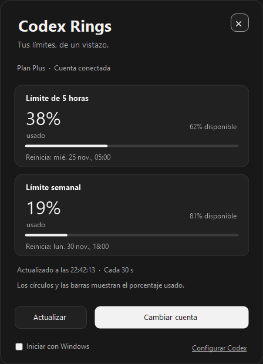

# Codex Rings

Two white progress rings for your Codex plan limits, directly in the Windows notification area. Click either ring to see five-hour and weekly usage, remaining allowance, reset times and account actions.

[Download the latest release](https://github.com/AlexRoac/codex-rings/releases/latest) · [Full Spanish documentation](../README.md)

## Requirements and setup

- Windows 11 x64 and .NET Framework 4.8 or later.
- An official Codex installation supporting `app-server`; the Codex binary is not bundled.
- A ChatGPT account with Codex plan limits. API-key-only authentication may not return plan quotas.

Download `CodexRings.exe`, place it in a stable folder and launch it. Use your existing Codex session, or click **Conectar cuenta** to sign in through the official browser flow. Use **Configurar Codex** to select `codex.exe` if it is not detected. The UI is currently in Spanish.

Drag both icons from the hidden-icons menu onto the visible taskbar. Windows controls their order; hover over each one to identify its quota. Closing the panel leaves Rings running. Right-click a ring and choose **Cerrar Codex Rings** to exit.

The ZIP includes an optional `install.ps1` that copies the app into `%LOCALAPPDATA%\CodexRings` and creates desktop and startup shortcuts. Portable users can enable or disable startup using the panel checkbox.

## What the numbers mean

The number is the percentage **used**, not the remaining allowance. The arc shows the same percentage. Limits are read from Codex every 30 seconds without generating conversations. A dash means no current reading is available. Reset times use your Windows time zone.

Signing in changes the shared Codex session on your machine. Rings does not bundle an account, collect passwords or have its own telemetry. See [SECURITY.md](../SECURITY.md).

## Limitations

The enlarged 24 px rings are transparent child graphics attached to the taskbar, centered inside native notification-icon slots. If this integration is unavailable, Rings falls back to normal small tray icons. It does not replace Explorer or inject code. Windows taskbar modifications and platform updates may affect compatibility.

Live usage was verified with Codex CLI `0.171.0-alpha.13.2`. Other versions are not guaranteed. The v1 executable is unsigned and does not auto-update. SHA-256 checksums are attached to every release.

## Build

On Windows, run `./build.ps1`, `./test.ps1` and `./package.ps1`. No NuGet dependencies or Codex account are required for the automated checks. A complete sign-in and usage test requires Codex and an account.

MIT licensed. Independent community project; not affiliated with OpenAI.
